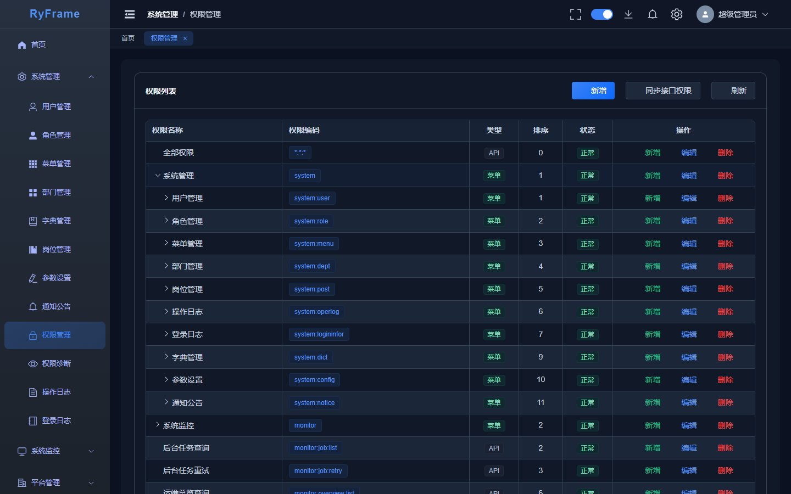

# RyFrame

[简体中文](README.md) · [Run locally](#first-run-after-downloading) · [Build your first business module](#develop-business-modules) · [Vue 3 frontend](https://github.com/Edgar-ycy/ryframe-vue3)

RyFrame helps you build administration apps with Rust and Vue 3. For an order management module, define the order model to generate CRUD endpoints and database migrations. Enable frontend synchronization to generate the list, form and routes as well. Reuse sign-in, role permissions, tenant isolation and operation logs while you write the rules specific to orders.



## First run after downloading

The `0.x` development series allows breaking changes to APIs, configuration and database schemas. Use matching frontend and backend contracts and a fresh isolated database. Keep your existing development database intact. Starting with the first stable release, `v1.0.0`, the project protects published contracts and data upgrade paths.

Backend and frontend are separate repositories. Run these Windows PowerShell examples from the backend root. First startup, integration, and optional development steps require no manual creation of Git-ignored directories. Tools create build and runtime directories as needed. MySQL, Redis and RustFS/MinIO/S3-compatible storage may run on any suitable platform or remote server. WSL is not required.

1. For native Windows builds, first install the “Desktop development with C++” workload in Visual Studio or Build Tools, including MSVC C/C++ tools for the target architecture and a Windows SDK; see the [official rustup Windows MSVC prerequisites](https://rust-lang.github.io/rustup/installation/windows-msvc.html). Then install rustup and run `rustup show` in the repository to select the stable toolchain, rustfmt and Clippy pinned by `rust-toolchain.toml`. Keep `vendor/` when building. Cargo uses `[patch.crates-io]` in `Cargo.toml` to load SQLx, SeaORM and OpenTelemetry sources from this repository. The first build still needs to download other dependencies missing from the local cache.
2. Prepare MySQL 8.0.16 or newer (MariaDB is not a substitute) and an account with the required schema, migration and application permissions. Redis uses a RESP connection; Redis 7.x is the current acceptance baseline (CI uses 7.4.9), with AUTH, an isolated database index and TLS configured as required by the deployment. Common configuration defaults file storage to a local directory, but `config/app.dev.toml` overrides it with RustFS. If no object storage service is used, explicitly switch the private development configuration to `local` as shown below. MinIO and S3-compatible services are also supported. Realtime messaging WebSocket tickets require available Redis; application readiness with `redis.mode="optional"` does not establish realtime messaging availability. For realtime messaging acceptance, configure `required` and provide reachable Redis.
3. Create an empty database with a database client, for example:

```sql
CREATE DATABASE ryframe_dev CHARACTER SET utf8mb4 COLLATE utf8mb4_general_ci;
```

4. Choose a private configuration directory outside the repository, such as `../ryframe-dev-config` next to the backend checkout. For a first-time setup, follow the [development guide](docs/development.en.md#starting-the-backend) to copy `config/app.toml` and `config/app.dev.toml`. Reuse an existing configuration if it already fits your setup. Enter real values only in private files and pass the same directory to each command with `--config-dir`. Set the database password, a random JWT secret of at least 32 bytes, and the initial administrator password directly in their fields. Administrator passwords require 8–72 visible ASCII characters, including uppercase, lowercase, digits and symbols.
5. Edit addresses, ports and users in `../ryframe-dev-config/app.dev.toml` using an editor. The following is a relevant field fragment for that copy; replace password placeholders and set `redis.password` directly if Redis requires authentication. The root field `snowflake_worker_id` must differ for every instance in the same deployment:

```toml
scope_id = "my-development"
snowflake_worker_id = 1
[bootstrap]
admin_password = "Replace-With-Strong-Admin-Password1!"
[database.primary]
host = "127.0.0.1"
database = "ryframe_dev"
username = "ryframe_app"
password = "replace-with-mysql-password"
[auth]
jwt_secret = "replace-with-at-least-32-random-bytes"
[redis]
password = ""
[object_storage]
backend = "local"
local_base_dir = "uploads"
```

```powershell
$env:APP_ENV = "dev"
cargo migrate -- --config-dir ../ryframe-dev-config control up
cargo migrate -- --config-dir ../ryframe-dev-config control verify
cargo migrate -- --config-dir ../ryframe-dev-config tenant-data up --target shared-control
cargo migrate -- --config-dir ../ryframe-dev-config tenant-data verify --target shared-control
cargo serve -- --config-dir ../ryframe-dev-config
```

The daily Cargo aliases use the checked-in `Cargo.lock`. `up` initializes or upgrades the selected control database; `verify` only validates. On a new empty database, running `control verify` first reports an incomplete ledger or schema; it cannot replace first-time initialization. The control database and the `shared-control` tenant data plane have separate ledgers, so the default single-tenant setup also requires both initialization and verification commands. API and Worker do not execute DDL at startup. The default API port is 8080. In nonproduction environments, `jobs.mode="embedded"` is the default and `cargo serve -- --config-dir ../ryframe-dev-config` consumes background jobs in the same process. To run a separate Worker, first copy both files from the configured `../ryframe-dev-config` into two new directories, `../ryframe-api-config` and `../ryframe-worker-config`, for API and Worker respectively. In an editor, set the root field to API `snowflake_worker_id=1` and Worker `snowflake_worker_id=2`, set `jobs.mode="external"` in both, and keep scope, database, Redis and JWT settings consistent within the deployment. Follow the [two-directory steps in the development guide](docs/development.en.md#starting-the-backend) to create the files, then run `cargo serve -- --config-dir ../ryframe-api-config` and `cargo worker -- --config-dir ../ryframe-worker-config` in separate terminals instead of sharing the default configuration directory. The file configuration above switches development storage from RustFS to `uploads`; for RustFS, MinIO or S3, set the corresponding backend, HTTPS endpoint, plaintext credentials and region in `object_storage`, then confirm service protocol and connectivity. If the isolated development MySQL server does not enable TLS, set `database.primary.tls_mode="disabled"` explicitly; remote production must use `verify_identity`. Install and start the frontend separately, following its README.

The initial ordinary account `user`, newly created users and imported ordinary users start with `123456`; administrators use the explicitly configured password. Every new account must change its password before business access, then sign in again. Repeated migration does not reset existing passwords or the change requirement. For an existing development account with an unknown password, use the [explicit recovery flow](docs/api.en.md#recovering-accounts-with-unknown-passwords): an administrator issues a one-time link and the user chooses a new password.

New configurations default to single tenancy, using the internal system tenant without a login tenant selector. Enable multiple tenants with `multi_tenancy.enabled = true` in the configuration file. Existing explicit settings remain effective. Configuration transfer and data maintenance remain available in single tenancy. Plans may have no optional capabilities. Notices and tenant message publishing can be enabled per plan; disabling them preserves history and does not disable system notifications, scheduling, imports, exports, backups or recovery.

## Databases, configuration and SQL import

`APP_ENV=dev|test|prod` is the only project configuration environment entry. Configuration recursively merges optional common `app.toml` and the mandatory `app.<environment>.toml` in order. Without the common file, the environment file must supply every required setting; an existing unreadable or malformed common file still fails; passwords, JWT, monitoring, Redis and storage credentials use plaintext fields directly. CLI option `--config-dir <directory>` selects a configuration directory, defaulting to `config`; this page's local examples explicitly use the external `../ryframe-dev-config` directory. Application-relative paths resolve from the current working directory, while generator-relative paths resolve from the backend Workspace root. Arrays are replaced as a whole in environment files and cannot be patched item by item. The [data guide](docs/data.en.md#tenant-routing) explains primary, replicas, sources, shared control storage, shared business storage, dedicated tenant databases, placement, TLS, pool limits and a complete database-topology TOML fragment to merge into the application configuration. Set `app.locales_dir` explicitly in TOML; its default is `locales`, resolved from the process current working directory for ordinary applications. `APP_LOCALES_DIR` is not read; missing resources fail strictly in production, while development can use embedded resources as a fallback. Framework maintainers can find the shared MySQL test configuration in [integration verification](docs/development.en.md#integration-verification). Four-role deployment templates and private configuration directories are integrated, with asset structure checks and CI tool tests passing. Real containers, images and the complete deployment flow remain unaccepted; partial validation does not establish a complete gate pass.

```powershell
cargo migrate -- --config-dir ../ryframe-dev-config control export-sql --output D:/ryframe-private/migration/control-init.sql --write
```

Use migrations to initialize the database. For direct SQL import, first export the complete script with the command above. Replace the example `--output` with an absolute path to a private file outside the working tree. The path must contain no `..` components. The export command creates missing parent directories and rejects an existing destination. Then choose an empty database and import with stop-on-error behavior as described in the [data guide](docs/data.en.md#control-database-initialization-sql), then run `cargo migrate -- --config-dir ../ryframe-dev-config control verify`. The deployment export includes password hashes, deferred constraints, seeds and the migration ledger. `sql/ryframe_config.sql` is a source review snapshot, not a deployment script. Interrupted imports are not automatically replayed or cleared, and `control up` is not used to guess how to repair them. This SQL initializes the control plane and `shared-control` tenant data plane in the selected physical database, including both ledgers and registered business migrations for both scopes. After a successful import, run `control verify` and `tenant-data verify --target shared-control` directly, without an additional initialization `up`. Independent MySQL tenant targets still need separate `tenant-data up` and `verify`; a single SQL file does not initialize multiple instances. SQL verifies actual structure before recording each business migration, then rechecks framework and business structures and ledgers. A mismatch stops the import; valid DDL that differs from its declaration is not recorded as complete.

Create and register empty tenant business databases before running `cargo migrate -- --config-dir ../ryframe-dev-config tenant-data up --target <target-key>` and `verify`. `--target` takes the configured target key, not the database name; `--all` processes registered targets only. Use `cargo reset -- <arguments>` for controlled nonproduction rebuilding after stopping API, Worker and schedulers; see the [operations guide](docs/operations.en.md).

`cargo xtask dev --config-dir ../ryframe-dev-config` manages the API and Worker through complete private file snapshots. Saving ports or the root instance identifier switches generations while reusing binaries; failures restore the previous configuration and ports. Relative configuration directories resolve against the backend Workspace root and can also be selected through `[development].config_dir` in tool files. `--plan` does not read configuration or execute tasks.

## Develop business modules

`new-business` creates the business crate and SDK/process registration. `resource` generates CRUD, migrations and managed assets from handwritten Rust models. Both preview by default and write only with `--write`. The crate, registration and lockfile are installed together without upgrading existing locked dependencies. Define and register models before generation as explained in the [development guide](docs/development.en.md#creating-a-business-crate):

Tenant business models use `database="tenant"`, table names starting with `biz_`, and a primary key containing `tenant_id`. Global models without `tenant_id` use `database="control"`, allow safe table identifiers such as `table1`, and are restricted to the system tenant by default. Enabling multi tenancy does not share global tables automatically; shared reads require explicit business extensions. After generation, review and run `cargo migrate -- --config-dir ../ryframe-dev-config control up` to initialize business menus and permissions, then run `control verify`. New tenant administrators receive tenant business CRUD permissions by default; ordinary users and extension operations require explicit grants.

Keep handwritten code in `resources/` and `extensions/`. The default generator is offline; enable `schema-import` only for read-only import from an existing database.

```powershell
cargo generate -- new-business order-business --write
# Define and register models, then preview before writing
cargo generate -- resource --package order-business
cargo generate -- resource --package order-business --model Order --write

# Optional read-only import from existing tables, separate from the model-driven flow above
cargo generate --features schema-import -- import --package order-business --connection primary --database tenant --tables biz_order,biz_order_item --config-dir ../ryframe-dev-config
```

`--connection` selects only the read-only schema source and accepts `primary`, `sources.<name>` or `tenant_data.targets.<target-key>`. `--database` independently selects the generated models' runtime scope; the two settings are not coupled. Import generates models, CRUD and migrations as one batch, preserves original schemas in `.ryframe/imports/`, and changes neither the database nor ownership of existing tables. `owner_field` names an `i64` or `Option<i64>` field containing a user ID; generated creation writes the current user, and list, detail, update and delete use the same data scope. Enable `generator.sync_frontend` or `--sync-frontend` to generate the current candidate OpenAPI, typed callers, lists, forms and routes; type and lint checks finish before both repositories are installed together. Preview writes only isolated caches; `--no-sync-frontend` temporarily disables synchronization. Unsupported structures reject the whole batch. Field `sql_type` preserves supported physical types, capacities and datetime precision; table and column collations participate in verification. Configure tool defaults and the frontend directory in `config/tools.toml`. Framework maintainer acceptance may use local overrides in `.local-tests/tools.toml`. Tool configuration has no environment-variable override. Generator application-directory priority is explicit `--config-dir <directory>` / Builder `.configuration_directory(path)`, local tool file, common tool file, then `workspace/config`; relative paths in optional `[generator] config_dir` also resolve from the backend Workspace root. `cargo generate -- run` consumes configured `tables` or `models`. The Rust `GenerationBuilder` accepts `.include_tables(["biz_order", "biz_order_item"])`; edit and run the [example](crates/ryframe-generator/examples/generate.rs). See the development guide for the complete workflow and the [data guide](docs/data.en.md#adopting-existing-tables) for explicit adoption plans, execution and failure inspection of existing tables.

Exact Decimal fields must explicitly declare `sql_type="DECIMAL(p,s)"`, with 1≤p≤28 and 0≤s≤p; APIs and forms use decimal strings and reject values beyond capacity. Generated forms provide text/textarea, integer, switch, date, date-time, enumerated radio and exact Decimal text controls by field type. JSON uses an editable textarea and strict parsing before submission; standard JSON query filters are rejected and require a strongly typed extension. See the development guide for model declarations and defaults.

## Checks, contracts and builds

Daily backend checks do not require the frontend. Explicitly choose all for complete cross-repository checks. Update tool configuration when renaming or relocating the frontend:

```powershell
cargo xtask check
cargo xtask check --scope all --full
cargo xtask generate api --write
cargo xtask build --plan
cargo xtask build
```

Contract synchronization exports the current backend candidate OpenAPI and atomically updates frontend derivatives. Formal source binding has additional verification requirements. Builds compare source fingerprints before and after execution; `--plan` does not execute tasks. Recovery, browser and performance acceptance still require evidence for the current source. Historical measurements do not establish readiness of the modified version, and this candidate has not been declared ready for a stable release.

The read-only `--plan` guarantee applies to tasks after the tool starts: no task execution, business-descriptor compilation, database connections, locks, generation caches or reports. `cargo generate` and `cargo xtask` use existing Cargo aliases, so first use or tool source changes may first compile the tool and write to its build directory. To avoid bootstrap build writes, build explicitly first and then run the same executable reported by Cargo with `--plan`.

## Documentation

- [Architecture and extension points](docs/architecture.en.md): module boundaries, SDK and assembly.
- [Development](docs/development.en.md): toolchain, startup, models and generation.
- [API](docs/api.en.md): sessions, authentication, errors and contracts.
- [Data](docs/data.en.md) covers initialization, tenant routing, copying and recovery across databases. First initialization records database ownership. For an existing unowned database, [plan explicit adoption](docs/data.en.md#initial-ownership-registration-and-explicit-adoption-of-existing-databases). An ownership conflict leaves business data intact.
- [Operations](docs/operations.en.md): deployment, upgrades, reset and troubleshooting.

OpenAPI, the access catalog, configuration types and command help define fields, menus, permissions and defaults. Optional MQTT, email and optimistic-locking plugins are future work; this iteration adds no placeholder interfaces or extra service requirements.
